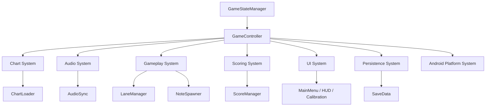

# HexaRhythm Architecture Audit

## Executive summary

The project already contains a usable Godot 4 foundation, but it is not yet a cohesive gameplay architecture. The codebase is split across several partial systems, yet the game lifecycle, lane configuration, hit detection, and Android build pipeline are not fully integrated or verified.

## Confirmed findings

### 1. Main menu is not fully wired
- [godot_project/scenes/MainMenu.tscn](../godot_project/scenes/MainMenu.tscn) defines `PlayButton`, `CalibrateButton`, `SyncButton` and a song list, but no explicit scene wiring or state transitions are present in the script attached to the scene.
- The menu script attached in the scene is [godot_project/scripts/MenuNetworkSyncReceiver.gd](../godot_project/scripts/MenuNetworkSyncReceiver.gd), which handles network download flow but not the full menu lifecycle.
- Result: the menu is only partially interactive and does not provide a clean game-state transition path.

### 2. Gameplay systems are disconnected
- [godot_project/scenes/GameScene.tscn](../godot_project/scenes/GameScene.tscn) contains `LaneManager`, `NoteSpawner`, `AudioPlayer` and `HUD`, but no central controller bridges these systems.
- [godot_project/scripts/NoteSpawner.gd](../godot_project/scripts/NoteSpawner.gd) updates visual notes based on `AudioSync.active_playback_flag`, while [godot_project/scripts/ScoreManager.gd](../godot_project/scripts/ScoreManager.gd) reads the same timing state but is not coordinated by a single state manager.
- Result: the gameplay loop is split across independent systems without a shared lifecycle contract.

### 3. Scoring and miss logic are inconsistent
- In [godot_project/scripts/ScoreManager.gd](../godot_project/scripts/ScoreManager.gd), the completion path and miss logic were directly coupled to an active playback flag, making finalization logic unreachable in the previous version.
- Invalid lane taps are treated as misses without checking whether the lane had a valid note candidate, which can wrongly reset combo states.
- Result: scoring contains functional bugs that can invalidate the overall rhythm loop.

### 4. Lane count is inconsistent with the game design
- The design goal is a 4-lane game, but the implementation had drifted toward six lanes in both [godot_project/scripts/LaneManager.gd](../godot_project/scripts/LaneManager.gd) and the sample chart metadata.
- The architecture now defaults the MVP to four lanes and keeps support for a six-lane fallback only where explicit configuration is needed.
- Result: lane layout and chart data are being normalized to a single consistent MVP contract.

### 5. Chart validation is shallow
- [godot_project/scripts/ChartLoader.gd](../godot_project/scripts/ChartLoader.gd) verifies JSON parseability and required root keys, but it does not robustly validate lane range, note type, timestamp validity, or hold duration values.
- Malformed data can still be accepted or partially processed, which risks runtime failures.
- Result: chart integrity is not yet safe enough for production-grade rhythm gameplay.

### 6. Calibration is incomplete and not scene-wired
- [godot_project/scenes/CalibrationScene.tscn](../godot_project/scenes/CalibrationScene.tscn) defines the UI but no connected script or scene lifecycle bridge is present.
- [godot_project/scripts/OffsetCalibration.gd](../godot_project/scripts/OffsetCalibration.gd) exists, but the calibration workflow is not connected to the button scene or game state.
- Result: the calibration button in the menu cannot reliably drive a valid workflow.

### 7. Android build environment is not ready
- The current environment does not have Godot 4, `adb`, or Java installed.
- This is confirmed by the terminal checks run in the workspace: `godot` is not available, `adb` is not available, and `java` is not available.
- Result: Android export and device validation are blocked at the environment level.

### 8. Essential assets are missing
- [godot_project/project.godot](../godot_project/project.godot) references `res://assets/textures/icon.svg`, but the asset is absent from the workspace.
- There is no real licensed playable song in the project assets.
- Result: the game cannot be shipped as a polished MVP without demo content and visual branding.

### 9. Repository hygiene is incomplete
- There is no `.gitignore` file at the root.
- Python cache files, Godot temporary data, build outputs, and local secrets are not excluded.
- Result: repository hygiene would degrade quickly during development and Android builds.

## Proposed modular architecture

The long-term structure should separate responsibilities into distinct systems while preserving a small MVP footprint.



## Proposed directory structure

```text
godot_project/
  project.godot
  scenes/
    MainMenu.tscn
    CalibrationScene.tscn
    GameScene.tscn
  scripts/
    core/
      GameConfig.gd
      GameStateManager.gd
      GameController.gd
    audio/
      AudioSync.gd
    chart/
      ChartLoader.gd
    gameplay/
      LaneManager.gd
      NoteSpawner.gd
    ui/
      MenuNetworkSyncReceiver.gd
      OffsetCalibration.gd
    scoring/
      ScoreManager.gd
    platform/
      AndroidLifecycle.gd
    persistence/
      SaveData.gd
```

## Migration steps

1. Keep the existing systems as compatibility adapters while introducing `GameStateManager` and `GameConfig`.
2. Standardize lane configuration around a single default count for the MVP.
3. Add a central game controller that owns transitions and shared resources.
4. Replace ad-hoc direct references with explicit signals and lifecycle delegates.
5. Add validation and safe defaults for chart data before any gameplay use.
6. Add Android build and export setup after the engine/toolchain is installed.
7. Validate gameplay on a physical device only after the architecture is stable enough.

## Risks and blockers

- No Godot 4 toolchain is installed in this environment, so runtime verification remains blocked.
- No Android device or emulator is available, preventing real hardware validation.
- Missing app assets and a real demo track prevent a polished MVP demo.
- The current project is still partial; large-scale rewrites should be avoided before the architecture is stabilized.

## Recommended next phase

Proceed with a small modular architecture foundation and documentation, then move to a focused gameplay integration pass once the environment is available and the architecture has been reviewed.
