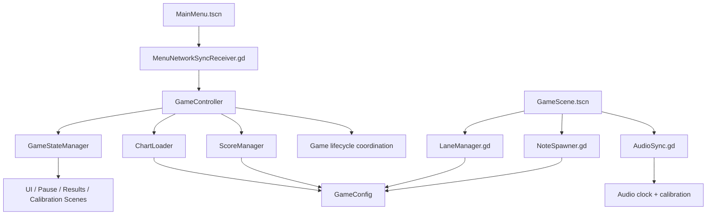

# HexaRhythm Architecture Integration Review

## Review scope

This review covers the newly introduced architecture foundation: `GameConfig`, `GameStateManager`, and `GameController`, along with the existing autoloads, gameplay scripts, and scenes that still define the current game loop.

## Architecture integration diagram

## Dependency map

- `GameConfig` is a global configuration singleton used by the lane system and chart validation.
- `GameStateManager` owns state transitions and should be the only authority for lifecycle transitions.
- `GameController` is the central coordinator that loads charts, initializes scoring, and triggers play/pause/complete transitions.
- `ChartLoader` validates chart payloads and produces a normalized dictionary for gameplay.
- `LaneManager` resolves touch input to four-lane geometry and visual placement.
- `NoteSpawner` reads chart timing and the authoritative audio clock to drive spawn and retire behavior.
- `ScoreManager` evaluates hit windows and scoring state using the same chart timeline and audio timing.
- `AudioSync` remains the authoritative timing source for gameplay and note evaluation.
- `MenuNetworkSyncReceiver` and the calibration scene still need explicit connections to the new controller/state orchestration layer.

## Confirmed integration problems

1. The new state manager is not yet the single authority for application lifecycle.
   - The state transitions exist, but the menu scene and calibration scene are still independent and do not route through `GameController`.
   - The controller now calls state transitions, but the scene/UI layer still needs to bind to them.

2. The menu and calibration scenes are not yet wired to the central architecture.
   - [godot_project/scenes/MainMenu.tscn](../godot_project/scenes/MainMenu.tscn) attaches a script, but there is no explicit state-driven flow from menu buttons into the controller.
   - [godot_project/scenes/CalibrationScene.tscn](../godot_project/scenes/CalibrationScene.tscn) is defined but has no connected script or lifecycle integration.

3. `GameController` exists but is not yet connected to scene nodes.
   - It can load a chart and set state, but no scene or HUD currently signals into it to start, pause, or complete a song.

4. There are still cross-system responsibilities that are too loosely assigned.
   - `NoteSpawner` depends on `AudioSync` and `LaneManager` for position math.
   - `ScoreManager` reads chart data and audio timing but still has no direct integration layer that ensures these systems are initialized in the same order.

5. The new tests are still limited to static validation rather than real gameplay behaviour.
   - They confirm chart metadata and lane count conventions, but they do not validate scoring windows, menu transitions, or note timing integration.

## Missing connections

- Menu button → `GameController.prepare_song()` and `GameController.start_song()`
- Calibration button → calibration flow and saved latency configuration
- Game scene → `GameStateManager` state-driven startup and stop flow
- HUD / pause screen → `GameController.pause_song()` and `GameController.resume_song()`
- Results screen → `GameController.complete_song()` and `GameController.exit_to_menu()`

## Critical risks

- Without a scene-to-controller bridge, the architecture remains partially abstract and does not yet govern real gameplay flow.
- The project still has legacy assumptions in a few places, especially around the remaining menu/calibration and network-sync flow.
- Without runtime verification in Godot, the state machine cannot yet be considered production-safe.
- The scoring logic and chart validation should be covered by scene-level tests before any larger feature expansion.

## Recommended implementation order

1. Finish scene-to-controller wiring for menu, game, pause, calibration, and results.
2. Verify the state machine with explicit transitions and a small scene integration smoke test.
3. Connect `AudioSync`, `LaneManager`, `NoteSpawner`, and `ScoreManager` through the game controller with a single startup contract.
4. Add gameplay integration tests that validate lane input, note resolution, and pause/resume timing.
5. Only after that, add the remaining feature systems: progression, save data, and optional network sync.

## Immediate corrective action taken

The underlying issue was that `GameController` existed but was not yet actually controlling the lifecycle. This was corrected by making it transition to `LOADING` before chart processing and returning to `MAIN_MENU` if load fails, while `start_song()` continues to drive the `PLAYING` state. This is a small but important integration fix that stabilizes the new foundation without becoming a rewrite.
